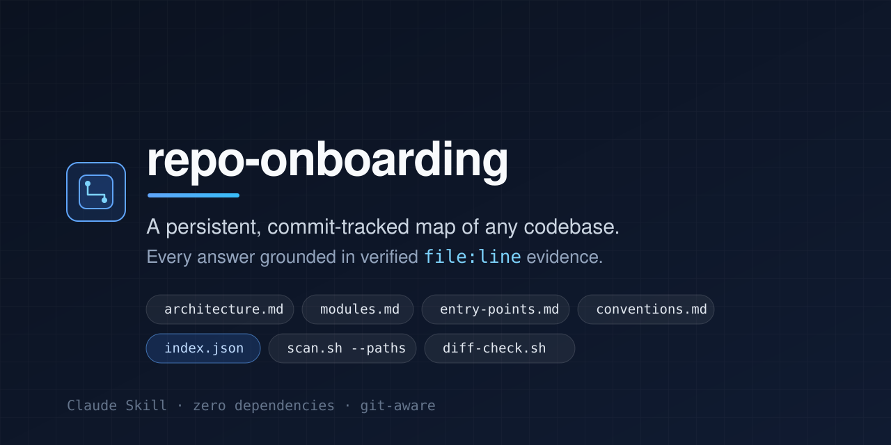
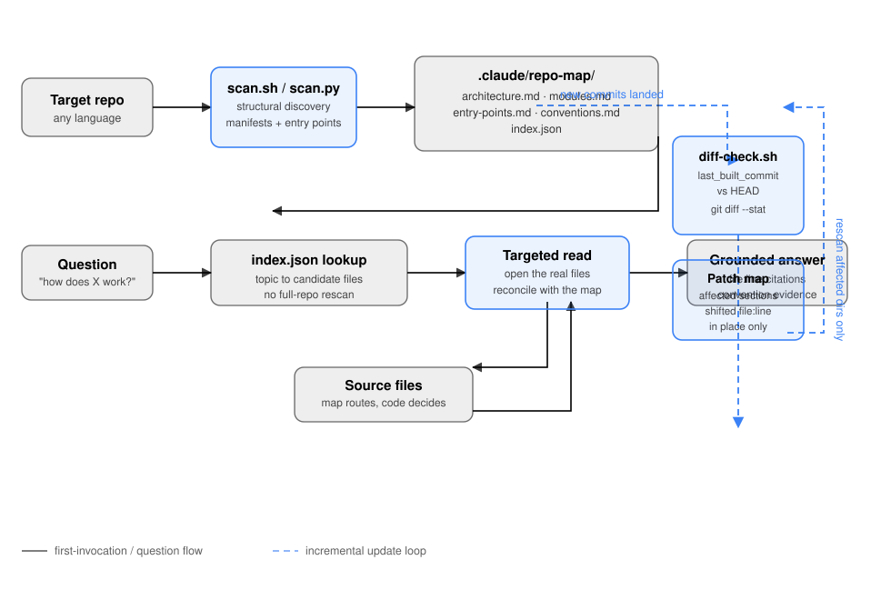

[English](README.md) | [简体中文](README.zh-CN.md)



> **Description**: Persistent, commit-tracked codebase architecture and convention mapper for Claude Skills and AI coding agents.
> **Topics**: `claude-skills` · `ai-agents` · `developer-tools` · `onboarding`

`repo-onboarding` is a Claude Skill (`SKILL.md` + zero-dependency discovery scripts) that gives Claude an accurate, persistent mental map of any codebase it is dropped into. Instead of burning tokens re-scanning directories from scratch every session — or guessing from shallow filename matches — Claude builds a commit-tracked map in `.claude/repo-map/`, updates it incrementally via `git diff <last-hash>..HEAD --stat`, and answers `"how does X work here?"` or `"where do I change Y?"` with verified `file:line` citations.

## Why `repo-onboarding`?

When LLMs onboard to unfamiliar codebases, they usually re-derive structure from scratch every session, wasting tokens and giving shallow or wrong answers:

1. **Shallow Guessing**: Answering architectural or modification questions after reading only one or two files, missing custom error hierarchies, auth middleware, or structured logging wrappers.
2. **Repeated Cold-Start Scans**: Re-running broad file trees and `grep` sweeps at the start of every session, wasting context window capacity and latency on unchanged code.

`repo-onboarding` persists and grounds that understanding across sessions:

- **First Invocation (Full Structural Scan)**: Runs a language-agnostic discovery pass (`scripts/scan.sh`) and synthesizes five structured files into `.claude/repo-map/`.
- **Subsequent Invocations (Git Commit Diff Check)**: Compares `last_built_commit` in `.claude/repo-map/index.json` against `HEAD` (`scripts/diff-check.sh`). If unchanged, the map is used immediately. If commits landed, only the affected directories are re-scanned (`git diff <last-hash>..HEAD --stat`) and patched in place.
- **Evidence-First Q&A**: Uses `.claude/repo-map/index.json` as a fast routing table to locate candidate files, then reads those actual source files before answering so every response cites exact `file:line` references and reconciles any uncommitted local changes.

## How It Works



1. **Scan**: `scripts/scan.sh` walks the repository and collects directory topology, manifest declarations, entry-point candidates, and convention samples, each tagged with a `file:line` reference.
2. **Map**: Claude reads the primary entry points and core modules the scan surfaced, then writes `architecture.md`, `modules.md`, `entry-points.md`, `conventions.md`, and `index.json` into `.claude/repo-map/`.
3. **Route and Read**: A question is routed through `index.json` to a short list of candidate files. Those files are opened and read before anything is claimed.
4. **Answer**: The reply cites the exact `file:line` locations it verified, and points at the conventions file so any change matches existing style.
5. **Update**: On the next invocation, `scripts/diff-check.sh` compares `last_built_commit` with `HEAD`. If commits landed, only the affected directories are re-scanned and the affected map sections are patched in place; untouched descriptions are left alone.

The map is a routing layer and a summary. It is never the sole source for a code-level claim.

## What Gets Generated in `.claude/repo-map/`

```text
.claude/repo-map/
├── architecture.md   # High-level system shape: major components, how they connect, data flow
├── modules.md        # Per-directory/module summary: purpose, key files, inbound & outbound dependencies
├── entry-points.md   # Where execution starts (main functions, API routes, CLI commands, workers) with file:line refs
├── conventions.md    # Inferred real patterns (errors, tests, naming, imports, logging) backed by 1-2 file:line examples
└── index.json        # Lightweight machine-readable map: {topic/module -> [relevant file paths]} + last_built_commit
```

## Installation

### Option 1: Install via the Claude Code plugin marketplace

This repository is its own plugin marketplace (`.claude-plugin/marketplace.json`), so Claude Code can install the skill directly. One step on Claude Code 2.1.275 or later:

```text
/plugin install repo-onboarding --marketplace janghotan/repo-onboarding
```

Or add the marketplace first, then install from it:

```text
/plugin marketplace add janghotan/repo-onboarding
/plugin install repo-onboarding@repo-onboarding
```

To check what was installed and remove it later:

```text
/plugin list
/plugin uninstall repo-onboarding@repo-onboarding
```

### Option 2: Standalone `.claude/skills/` Drop-In (Per-Repo or Global)

Clone or copy `repo-onboarding` directly into your repository's `.claude/skills/` directory (or `~/.claude/skills/` for global availability across all repositories):

```bash
# Per-repository drop-in
mkdir -p .claude/skills
git clone https://github.com/janghotan/repo-onboarding.git .claude/skills/repo-onboarding

# Or global drop-in for your user account
mkdir -p ~/.claude/skills
git clone https://github.com/janghotan/repo-onboarding.git ~/.claude/skills/repo-onboarding
```

Both `scripts/scan.sh` (`scripts/scan.py`) and `scripts/diff-check.sh` use only standard POSIX utilities, `git`, and the Python 3 standard library — zero third-party dependencies required.

## Using repo-onboarding with other AI coding agents

There is no cross-agent installer. Claude Code has a plugin marketplace; nothing else does. For every other agent the mechanism is the same: clone this repo somewhere permanent, then put a short pointer in whatever project-instructions file that agent loads automatically, telling it to read `SKILL.md` before doing onboarding-style work.

The skill itself does not change — it is still `SKILL.md` plus `scripts/`, and the map it writes still lands in `.claude/repo-map/` inside the target repository.

```bash
git clone https://github.com/janghotan/repo-onboarding.git ~/.repo-onboarding
```

In the snippets below, `CLONE_PATH` means the absolute path where you cloned it. Every snippet is also checked into [`snippets/`](snippets/) so you can copy a file instead of editing one.

### Any agent that reads a project instructions file (recommended default)

`AGENTS.md` is an open format, read today by OpenAI Codex, Cursor, Windsurf / Devin Desktop, GitHub Copilot agents, and OpenCode. Copy [`snippets/AGENTS.md.example`](snippets/AGENTS.md.example) to your project root as `AGENTS.md` and set `CLONE_PATH`:

```markdown
## Codebase onboarding (repo-onboarding)

When asked to onboard to this codebase, give an architecture overview, explain how
something works here, or where to make a change, read `CLONE_PATH/SKILL.md` first and
follow its process: run `scripts/diff-check.sh` to check for an existing map at
`.claude/repo-map/`, scan on a first run or re-scan only the affected directories after
new commits, and always read the real source files before citing `file:line` locations.
```

### Cursor

Cursor reads project rules from `.cursor/rules/*.mdc` (the extension must be `.mdc`; a plain `.md` file there is ignored because it has no frontmatter). Copy [`snippets/cursor-repo-onboarding.mdc`](snippets/cursor-repo-onboarding.mdc) to `.cursor/rules/repo-onboarding.mdc`. Its frontmatter uses `description` plus `alwaysApply: false`, so Agent pulls the rule in when the task matches; use `alwaysApply: true` to load it every session.

```markdown
---
description: "Codebase onboarding with the repo-onboarding skill"
alwaysApply: false
---

When asked to onboard to this codebase, explain its architecture, answer "how does X work
here", or say where to change Y, read `CLONE_PATH/SKILL.md` and follow its process. Cite
real `file:line` references.
```

Cursor also reads `AGENTS.md` at the project root and in subdirectories, which is the simpler option if you do not want rule frontmatter.

### Windsurf / Devin Desktop

Windsurf reads workspace rules from `.devin/rules/*.md` (preferred) or `.windsurf/rules/*.md` (legacy fallback), plus the legacy single-file `.windsurfrules`. Copy [`snippets/windsurf-repo-onboarding.md`](snippets/windsurf-repo-onboarding.md) to `.devin/rules/repo-onboarding.md`. Frontmatter controls activation with `trigger`:

```markdown
---
trigger: model_decision
description: Codebase onboarding with the repo-onboarding skill
---

When asked to onboard to this codebase, or to explain how something works here, read
`CLONE_PATH/SKILL.md` and follow its process. Cite real `file:line` references.
```

`trigger` accepts `always_on`, `model_decision`, `glob`, or `manual`. A root-level `AGENTS.md` is also read and is always on.

### GitHub Copilot

Copilot reads repository-wide instructions from `.github/copilot-instructions.md`. Copy [`snippets/copilot-instructions.md`](snippets/copilot-instructions.md) there:

```markdown
# Codebase onboarding (repo-onboarding)

When asked to onboard to this codebase, explain how something works here, or say where to
make a change, read `CLONE_PATH/SKILL.md` first and follow its process. Cite real
`file:line` references.
```

For path-specific instructions Copilot uses `.github/instructions/NAME.instructions.md` with an `applyTo:` frontmatter glob. Copilot agents also read the nearest `AGENTS.md` in the directory tree, or a root `CLAUDE.md`.

### OpenAI Codex

Codex reads `AGENTS.md`, concatenating every one found from the project root down to the current directory (a local `AGENTS.override.md` takes precedence). Use [`snippets/AGENTS.md.example`](snippets/AGENTS.md.example) as your project's `AGENTS.md` — no extra configuration needed. Additional fallback filenames can be set with `project_doc_fallback_filenames` in Codex config.

### OpenCode

OpenCode reads `AGENTS.md` (a root `CLAUDE.md` is used as a fallback), and can be pointed at extra instruction files, including this skill's `SKILL.md`, via `instructions` in `opencode.json`:

```json
{
  "$schema": "https://opencode.ai/config.json",
  "instructions": ["CLONE_PATH/SKILL.md"]
}
```

See [`snippets/opencode.json.example`](snippets/opencode.json.example). OpenCode also discovers Claude Code skills in `~/.claude/skills/`, so the manual drop-in install from Option 2 works there too.

### Aider

Aider has no auto-loaded conventions file by convention, but it has a documented mechanism: `--read` marks a file read-only and keeps it in the chat, and `read` in `.aider.conf.yml` makes that permanent.

```yaml
# .aider.conf.yml
read: [CONVENTIONS.md]
```

Copy [`snippets/aider-conventions.md`](snippets/aider-conventions.md) to your project as `CONVENTIONS.md`.

### Any other agent, and the fallback that always works

If your agent supports a persistent project-instructions file, point it at `CLONE_PATH/SKILL.md` using the same wording as the `AGENTS.md` snippet above. If it does not, clone the repo anywhere and say this in your first message:

```text
Read /absolute/path/to/repo-onboarding/SKILL.md and follow it before answering. When you
need the structural scan, run its scripts/scan.sh and scripts/diff-check.sh.
```

That manual paste works with every agent that can read a file, including ones not listed here. PRs adding verified conventions for other agents are welcome — see [CONTRIBUTING.md](CONTRIBUTING.md).

## Usage Examples

### 1. First Onboarding & Architecture Overview

Ask Claude inside any repository:

```text
Onboard to this repo and give me an architecture overview. How do requests flow from the API to storage?
```

1. Runs `./scripts/diff-check.sh --from-index .` -> detects `STATUS: FULL_SCAN_NEEDED`.
2. Runs `./scripts/scan.sh . --format markdown` to collect directory topology, manifest dependencies (`package.json`, `pyproject.toml`, `go.mod`, `Cargo.toml`, `Makefile`, etc.), entry-point candidates, and convention probes.
3. Reads the primary entry points and domain modules, then writes `.claude/repo-map/{architecture.md,modules.md,entry-points.md,conventions.md,index.json}`.
4. Answers your question with concrete `file:line` references.

### 2. Answering "How Does X Work Here?"

```text
How does webhook delivery failure and dead-lettering work here?
```

**Sample Grounded Answer** (from [`examples/taskpulse-service/sample-qa-walkthrough.md`](examples/taskpulse-service/sample-qa-walkthrough.md)):

> Webhook delivery failures are handled across the worker dispatch loop (`src/workers/dispatcher.py`) and the SQLite repository (`src/storage/repository.py`):
>
> 1. **Batch Polling (`src/workers/dispatcher.py:30-39`)**: `run_worker_once()` calls `repo.fetch_pending_batch(limit=10)` (`src/storage/repository.py:74-79`), selecting up to 10 rows with `status = 'PENDING'` ordered by `created_at ASC`.
> 2. **Delivery & Exception Catching (`src/workers/dispatcher.py:12-27`)**: `dispatch_single_task()` calls `sender(record.target_url, record.payload)` inside `try ... except Exception as exc:` (`src/workers/dispatcher.py:19-27`). Non-2xx responses (`src/workers/dispatcher.py:24`) or transport exceptions (`src/workers/dispatcher.py:25-27`) call `repo.record_failure(record.task_id, max_attempts=settings.max_attempts)`.
> 3. **Retry vs. Dead-Letter Transition (`src/storage/repository.py:93-107`)**: `TaskRepository.record_failure()` increments `attempts` (`src/storage/repository.py:95`) and transitions `status` to `'DEAD_LETTER'` once `next_attempts >= max_attempts` (default `3` in `src/config.py:27`).

### 3. Answering "Where Do I Change Y?"

```text
Where do I change the code to add a POST /v1/tasks/{task_id}/retry endpoint that requeues a DEAD_LETTER task?
```

Claude routes via `.claude/repo-map/index.json` and `.claude/repo-map/conventions.md`, inspects `src/storage/repository.py`, `src/api/routes.py`, and `tests/test_taskpulse.py`, and provides an exact modification checklist matching the repository's error hierarchy (`InvalidTaskStateError` at `src/core/errors.py:36`), route naming (`handle_<verb>_<resource>` at `src/api/routes.py:21-45`), and structured logging (`extra={"structured_fields": ...}` at `src/core/logger.py:19`).

### 4. Incremental Updates After New Commits

When new commits land, `scripts/diff-check.sh` compares `last_built_commit` in `index.json` against `HEAD`:

```text
$ ./scripts/diff-check.sh --from-index /path/to/taskpulse
STATUS: INCREMENTAL_UPDATE_NEEDED
LAST_BUILT_COMMIT: 474926e43d1be1e144298853d7305ea25f4b2cd6
CURRENT_HEAD: e2a4eb25e5ecb1f799bb9fdddfaa5995c66fdf93
DIRTY_WORKING_TREE: false

=== DIFF STAT (474926e..e2a4eb2) ===
 src/api/routes.py         |  6 ++++++
 src/storage/repository.py | 13 +++++++++++++
 2 files changed, 19 insertions(+)

=== AFFECTED MODULES / DIRECTORIES ===
src/api
src/storage
```

Claude then rescans only the affected directories (`./scripts/scan.sh /path/to/taskpulse --paths src/api src/storage`) and patches the relevant sections in `.claude/repo-map/`.

## Worked Example (`examples/taskpulse-service/`)

Explore [`examples/taskpulse-service/`](examples/taskpulse-service/) to inspect a complete generated map and Q&A session before installing:

- [`examples/taskpulse-service/.claude/repo-map/architecture.md`](examples/taskpulse-service/.claude/repo-map/architecture.md)
- [`examples/taskpulse-service/.claude/repo-map/modules.md`](examples/taskpulse-service/.claude/repo-map/modules.md)
- [`examples/taskpulse-service/.claude/repo-map/entry-points.md`](examples/taskpulse-service/.claude/repo-map/entry-points.md)
- [`examples/taskpulse-service/.claude/repo-map/conventions.md`](examples/taskpulse-service/.claude/repo-map/conventions.md)
- [`examples/taskpulse-service/.claude/repo-map/index.json`](examples/taskpulse-service/.claude/repo-map/index.json)
- [`examples/taskpulse-service/sample-qa-walkthrough.md`](examples/taskpulse-service/sample-qa-walkthrough.md)
- [`examples/taskpulse-service/incremental-diff-output.txt`](examples/taskpulse-service/incremental-diff-output.txt)

## Development

Run the same checks CI runs before opening a pull request:

```bash
python3 scripts/validate.py .          # SKILL.md frontmatter, links, placeholders, example map
python3 -m py_compile scripts/scan.py  # syntax check
shellcheck scripts/scan.sh scripts/diff-check.sh
bash scripts/scan.sh . --format json | python3 -m json.tool > /dev/null
```

See [`CONTRIBUTING.md`](CONTRIBUTING.md) for the design principles and the full pull request checklist.

## License

Licensed under the [Apache License, Version 2.0](LICENSE).
