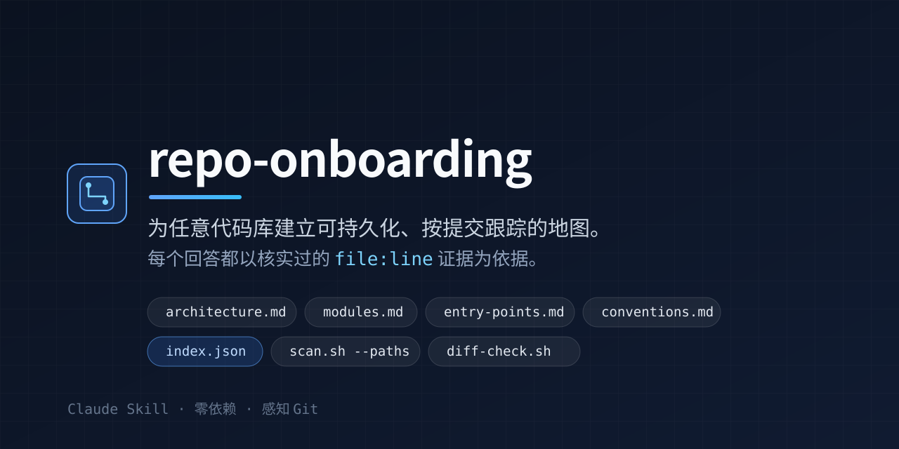
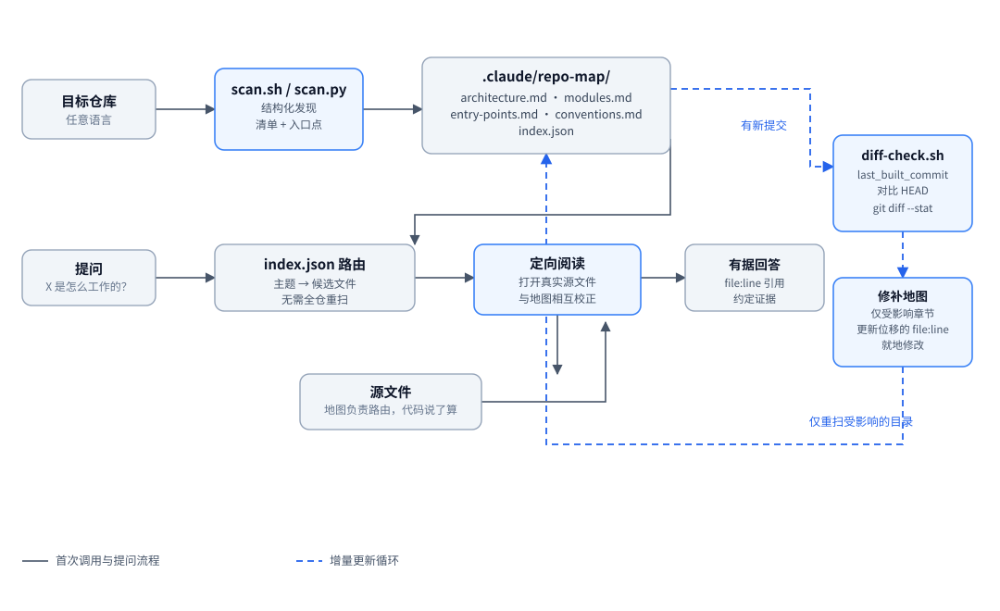

[简体中文](README.zh-CN.md) | [English](README.md)



> **简介**：面向 Claude Skills 与 AI 编码代理的可持久化、按提交跟踪的代码库架构与约定映射工具。
> **主题**：`claude-skills` · `ai-agents` · `developer-tools` · `onboarding`

`repo-onboarding` 是一个 Claude Skill（由 `SKILL.md` 和零依赖的发现脚本组成）。无论被放进哪个代码库，它都能让 Claude 获得一份准确、可长期保存的代码库“心智地图”。不必每个会话都从零重扫目录、白白消耗 token，也不必凭文件名草率猜测——Claude 会在 `.claude/repo-map/` 中建立一份按提交跟踪的地图，通过 `git diff <last-hash>..HEAD --stat` 增量更新，并在回答“这里的 X 是怎么实现的？”或“要改 Y 应该动哪里？”时给出经过核实的 `file:line` 引用。

## 为什么需要 `repo-onboarding`？

LLM 初到一个陌生代码库时，通常每个会话都要重新推导一遍结构，既浪费 token，给出的答案也流于表面甚至出错：

1. **浮于表面的猜测**：只读了一两个文件就回答架构或修改类问题，因而漏掉自定义错误层级、鉴权中间件或结构化日志封装。
2. **反复冷启动扫描**：每个会话开头都重跑大范围的文件树遍历和 `grep` 搜索，把上下文窗口和响应时间浪费在毫无变化的代码上。

`repo-onboarding` 让这种理解得以跨会话保留，并且始终有据可查：

- **首次调用（完整结构扫描）**：执行一次与语言无关的发现流程（`scripts/scan.sh`），并把五份结构化文件综合写入 `.claude/repo-map/`。
- **后续调用（Git 提交差异检查）**：将 `.claude/repo-map/index.json` 中的 `last_built_commit` 与 `HEAD` 比对（`scripts/diff-check.sh`）。如果没有变化，直接使用现有地图；如果有新提交，则只重扫受影响的目录（`git diff <last-hash>..HEAD --stat`）并就地修补。
- **证据优先的问答**：把 `.claude/repo-map/index.json` 当作快速路由表定位候选文件，然后先真正读取这些源文件再作答，因此每个回答都带有确切的 `file:line` 引用，并会校正本地未提交的改动。

## 工作原理



1. **扫描**：`scripts/scan.sh` 遍历仓库，收集目录结构、清单声明、入口候选点和约定样本，每一项都带有 `file:line` 引用。
2. **建图**：Claude 阅读扫描结果中浮现的主要入口和核心模块，然后把 `architecture.md`、`modules.md`、`entry-points.md`、`conventions.md` 和 `index.json` 写入 `.claude/repo-map/`。
3. **路由与阅读**：问题先经由 `index.json` 路由到一小份候选文件清单，这些文件会被打开阅读之后才会给出任何论断。
4. **作答**：回复中引用实际核实过的 `file:line` 位置，并指向约定文件，使任何改动都与既有风格一致。
5. **更新**：下次调用时，`scripts/diff-check.sh` 将 `last_built_commit` 与 `HEAD` 比对。如果有新提交，只重扫受影响的目录，并就地修补受影响的地图章节，未触及的描述保持原样。

地图只是路由层和摘要，绝不是代码级论断的唯一依据。

## `.claude/repo-map/` 中会生成什么

```text
.claude/repo-map/
├── architecture.md   # 系统整体形态：主要组件、彼此如何连接、数据流
├── modules.md        # 按目录/模块的总结：职责、关键文件、入向与出向依赖
├── entry-points.md   # 执行起点（main 函数、API 路由、CLI 命令、后台任务）及其 file:line 引用
├── conventions.md    # 从真实代码推断出的约定（错误处理、测试、命名、导入、日志），每条附 1-2 个 file:line 示例
└── index.json        # 轻量机器可读地图：{主题/模块 -> [相关文件路径]} + last_built_commit
```

## 安装

### 方式一：通过 Claude Code 插件市场安装

本仓库自身就是一个插件市场（`.claude-plugin/marketplace.json`），因此 Claude Code 可以直接安装这个 Skill。在 Claude Code 2.1.275 及以上版本中，一条命令即可完成：

```text
/plugin install repo-onboarding --marketplace janghotan/repo-onboarding
```

也可以先添加市场，再从市场中安装：

```text
/plugin marketplace add janghotan/repo-onboarding
/plugin install repo-onboarding@repo-onboarding
```

查看安装结果，或之后卸载：

```text
/plugin list
/plugin uninstall repo-onboarding@repo-onboarding
```

### 方式二：直接放入 `.claude/skills/`（按仓库或全局）

把 `repo-onboarding` 克隆或复制到仓库的 `.claude/skills/` 目录（若希望所有仓库都可用，则放到 `~/.claude/skills/`）：

```bash
# 按仓库安装
mkdir -p .claude/skills
git clone https://github.com/janghotan/repo-onboarding.git .claude/skills/repo-onboarding

# 或安装到当前用户的全局目录
mkdir -p ~/.claude/skills
git clone https://github.com/janghotan/repo-onboarding.git ~/.claude/skills/repo-onboarding
```

`scripts/scan.sh`（`scripts/scan.py`）和 `scripts/diff-check.sh` 只使用标准 POSIX 工具、`git` 和 Python 3 标准库，无需任何第三方依赖。

## 在其他 AI 编码代理中使用 repo-onboarding

目前没有跨代理的统一安装方式。Claude Code 有插件市场，其他工具并没有。对其他所有代理来说，做法是一样的：把本仓库克隆到一个固定位置，然后在那个代理会自动加载的项目指令文件里加一小段指引，告诉它在做上手类工作之前先读 `SKILL.md`。

技能本身没有任何变化，仍然是 `SKILL.md` 加 `scripts/`；它写出的地图也仍然落在目标仓库的 `.claude/repo-map/` 中。

```bash
git clone https://github.com/janghotan/repo-onboarding.git ~/.repo-onboarding
```

下面的片段中，`CLONE_PATH` 指你克隆到的绝对路径。所有片段也都已放在 [`snippets/`](snippets/) 目录中，可以直接复制文件，而不必手工编辑。

### 支持项目指令文件的任意代理（推荐默认方案）

`AGENTS.md` 是一种开放格式，目前 OpenAI Codex、Cursor、Windsurf / Devin Desktop、GitHub Copilot 代理和 OpenCode 都会读取。把 [`snippets/AGENTS.md.example`](snippets/AGENTS.md.example) 复制到项目根目录并改名为 `AGENTS.md`，再把 `CLONE_PATH` 换成实际路径：

```markdown
## Codebase onboarding (repo-onboarding)

When asked to onboard to this codebase, give an architecture overview, explain how
something works here, or where to make a change, read `CLONE_PATH/SKILL.md` first and
follow its process: run `scripts/diff-check.sh` to check for an existing map at
`.claude/repo-map/`, scan on a first run or re-scan only the affected directories after
new commits, and always read the real source files before citing `file:line` locations.
```

### Cursor

Cursor 从 `.cursor/rules/*.mdc` 读取项目规则（扩展名必须是 `.mdc`；放在该目录下的普通 `.md` 文件因为没有 frontmatter 会被忽略）。把 [`snippets/cursor-repo-onboarding.mdc`](snippets/cursor-repo-onboarding.mdc) 复制为 `.cursor/rules/repo-onboarding.mdc`。它的 frontmatter 使用 `description` 加 `alwaysApply: false`，因此 Agent 会在任务匹配时引入该规则；若希望每个会话都加载，改成 `alwaysApply: true`。

```markdown
---
description: "Codebase onboarding with the repo-onboarding skill"
alwaysApply: false
---

When asked to onboard to this codebase, explain its architecture, answer "how does X work
here", or say where to change Y, read `CLONE_PATH/SKILL.md` and follow its process. Cite
real `file:line` references.
```

Cursor 也会读取项目根目录和子目录中的 `AGENTS.md`，如果不想写规则 frontmatter，这是更简单的选择。

### Windsurf / Devin Desktop

Windsurf 从 `.devin/rules/*.md`（首选）或 `.windsurf/rules/*.md`（兼容旧版）读取工作区规则，也仍然读取旧式的单文件 `.windsurfrules`。把 [`snippets/windsurf-repo-onboarding.md`](snippets/windsurf-repo-onboarding.md) 复制为 `.devin/rules/repo-onboarding.md`。激活方式由 frontmatter 中的 `trigger` 控制：

```markdown
---
trigger: model_decision
description: Codebase onboarding with the repo-onboarding skill
---

When asked to onboard to this codebase, or to explain how something works here, read
`CLONE_PATH/SKILL.md` and follow its process. Cite real `file:line` references.
```

`trigger` 可取 `always_on`、`model_decision`、`glob` 或 `manual`。项目根目录的 `AGENTS.md` 也会被读取，并且始终生效。

### GitHub Copilot

Copilot 从 `.github/copilot-instructions.md` 读取仓库级指令。把 [`snippets/copilot-instructions.md`](snippets/copilot-instructions.md) 复制到该位置：

```markdown
# Codebase onboarding (repo-onboarding)

When asked to onboard to this codebase, explain how something works here, or say where to
make a change, read `CLONE_PATH/SKILL.md` first and follow its process. Cite real
`file:line` references.
```

若需按路径生效的指令，Copilot 使用 `.github/instructions/NAME.instructions.md`，并在 frontmatter 中用 `applyTo:` 指定 glob。Copilot 代理也会读取目录树中最近的 `AGENTS.md`，或根目录的 `CLAUDE.md`。

### OpenAI Codex

Codex 读取 `AGENTS.md`，会把从项目根目录到当前目录沿途找到的每一个都拼接起来（同目录下的 `AGENTS.override.md` 优先）。直接使用 [`snippets/AGENTS.md.example`](snippets/AGENTS.md.example) 作为项目的 `AGENTS.md` 即可，无需额外配置。也可以通过 Codex 配置中的 `project_doc_fallback_filenames` 增加备用文件名。

### OpenCode

OpenCode 读取 `AGENTS.md`（根目录的 `CLAUDE.md` 作为回退），并且可以在 `opencode.json` 的 `instructions` 字段中额外指定指令文件，包括本技能的 `SKILL.md`：

```json
{
  "$schema": "https://opencode.ai/config.json",
  "instructions": ["CLONE_PATH/SKILL.md"]
}
```

参见 [`snippets/opencode.json.example`](snippets/opencode.json.example)。OpenCode 也会发现 `~/.claude/skills/` 下的 Claude Code 技能，因此方式二的手动放入安装同样适用于它。

### Aider

Aider 默认并不会自动加载约定文件，但它有明确的机制：`--read` 会把文件标记为只读并保留在会话中，而在 `.aider.conf.yml` 中设置 `read` 可以让它长期生效。

```yaml
# .aider.conf.yml
read: [CONVENTIONS.md]
```

把 [`snippets/aider-conventions.md`](snippets/aider-conventions.md) 复制到项目里并命名为 `CONVENTIONS.md`。

### 其他代理，以及永远可用的兜底方案

如果你的代理支持持久的项目指令文件，就参照上面 `AGENTS.md` 的措辞，让它指向 `CLONE_PATH/SKILL.md`。如果不支持，可以把仓库克隆到任意位置，然后在第一条消息里这样说：

```text
Read /absolute/path/to/repo-onboarding/SKILL.md and follow it before answering. When you
need the structural scan, run its scripts/scan.sh and scripts/diff-check.sh.
```

只要代理能读取文件，这种手动粘贴的方式就管用，包括上面没有列出的工具。欢迎提交 PR 补充你验证过的其他代理约定，详见 [CONTRIBUTING.md](CONTRIBUTING.md)。

## 使用示例

### 1. 首次上手与架构概览

在任意仓库中向 Claude 提问：

```text
Onboard to this repo and give me an architecture overview. How do requests flow from the API to storage?
```

1. 运行 `./scripts/diff-check.sh --from-index .`，检测到 `STATUS: FULL_SCAN_NEEDED`。
2. 运行 `./scripts/scan.sh . --format markdown`，收集目录结构、清单依赖（`package.json`、`pyproject.toml`、`go.mod`、`Cargo.toml`、`Makefile` 等）、入口候选点和约定探测结果。
3. 阅读主要入口和领域模块，然后写入 `.claude/repo-map/{architecture.md,modules.md,entry-points.md,conventions.md,index.json}`。
4. 用具体的 `file:line` 引用回答你的问题。

### 2. 回答“这里的 X 是怎么工作的？”

```text
How does webhook delivery failure and dead-lettering work here?
```

**示例回答**（摘自 [`examples/taskpulse-service/sample-qa-walkthrough.md`](examples/taskpulse-service/sample-qa-walkthrough.md)）：

> Webhook 投递失败的处理分散在 worker 派发循环（`src/workers/dispatcher.py`）和 SQLite 仓储层（`src/storage/repository.py`）中：
>
> 1. **批量轮询（`src/workers/dispatcher.py:30-39`）**：`run_worker_once()` 调用 `repo.fetch_pending_batch(limit=10)`（`src/storage/repository.py:74-79`），按 `created_at ASC` 取出最多 10 条 `status = 'PENDING'` 的记录。
> 2. **投递与异常捕获（`src/workers/dispatcher.py:12-27`）**：`dispatch_single_task()` 在 `try ... except Exception as exc:`（`src/workers/dispatcher.py:19-27`）中调用 `sender(record.target_url, record.payload)`。非 2xx 响应（`src/workers/dispatcher.py:24`）或传输层异常（`src/workers/dispatcher.py:25-27`）都会调用 `repo.record_failure(record.task_id, max_attempts=settings.max_attempts)`。
> 3. **重试与死信状态的切换（`src/storage/repository.py:93-107`）**：`TaskRepository.record_failure()` 递增 `attempts`（`src/storage/repository.py:95`），一旦 `next_attempts >= max_attempts` 就把 `status` 置为 `'DEAD_LETTER'`（默认值 `3` 定义在 `src/config.py:27`）。

### 3. 回答“要改 Y 应该动哪里？”

```text
Where do I change the code to add a POST /v1/tasks/{task_id}/retry endpoint that requeues a DEAD_LETTER task?
```

Claude 会经由 `.claude/repo-map/index.json` 和 `.claude/repo-map/conventions.md` 路由，检查 `src/storage/repository.py`、`src/api/routes.py` 和 `tests/test_taskpulse.py`，然后给出一份精确的修改清单，并遵循仓库已有的错误层级（`src/core/errors.py:36` 处的 `InvalidTaskStateError`）、路由命名（`src/api/routes.py:21-45` 处的 `handle_<verb>_<resource>`）和结构化日志（`src/core/logger.py:19` 处的 `extra={"structured_fields": ...}`）。

### 4. 新提交之后的增量更新

有新提交时，`scripts/diff-check.sh` 会把 `index.json` 中的 `last_built_commit` 与 `HEAD` 比对：

```text
$ ./scripts/diff-check.sh --from-index /path/to/taskpulse
STATUS: INCREMENTAL_UPDATE_NEEDED
LAST_BUILT_COMMIT: 474926e43d1be1e144298853d7305ea25f4b2cd6
CURRENT_HEAD: e2a4eb25e5ecb1f799bb9fdddfaa5995c66fdf93
DIRTY_WORKING_TREE: false

=== DIFF STAT (474926e..e2a4eb2) ===
 src/api/routes.py         |  6 ++++++
 src/storage/repository.py | 13 +++++++++++++
 2 files changed, 19 insertions(+)

=== AFFECTED MODULES / DIRECTORIES ===
src/api
src/storage
```

随后 Claude 只重扫受影响的目录（`./scripts/scan.sh /path/to/taskpulse --paths src/api src/storage`），并修补 `.claude/repo-map/` 中相应的章节。

## 完整示例（`examples/taskpulse-service/`）

安装之前，可以先浏览 [`examples/taskpulse-service/`](examples/taskpulse-service/)，查看一份完整生成的地图和问答过程：

- [`examples/taskpulse-service/.claude/repo-map/architecture.md`](examples/taskpulse-service/.claude/repo-map/architecture.md)
- [`examples/taskpulse-service/.claude/repo-map/modules.md`](examples/taskpulse-service/.claude/repo-map/modules.md)
- [`examples/taskpulse-service/.claude/repo-map/entry-points.md`](examples/taskpulse-service/.claude/repo-map/entry-points.md)
- [`examples/taskpulse-service/.claude/repo-map/conventions.md`](examples/taskpulse-service/.claude/repo-map/conventions.md)
- [`examples/taskpulse-service/.claude/repo-map/index.json`](examples/taskpulse-service/.claude/repo-map/index.json)
- [`examples/taskpulse-service/sample-qa-walkthrough.md`](examples/taskpulse-service/sample-qa-walkthrough.md)
- [`examples/taskpulse-service/incremental-diff-output.txt`](examples/taskpulse-service/incremental-diff-output.txt)

## 开发

提交 PR 之前，先运行与 CI 相同的检查：

```bash
python3 scripts/validate.py .          # SKILL.md frontmatter、链接、占位符、示例地图
python3 -m py_compile scripts/scan.py  # 语法检查
shellcheck scripts/scan.sh scripts/diff-check.sh
bash scripts/scan.sh . --format json | python3 -m json.tool > /dev/null
```

设计原则和完整的 PR 检查清单见 [`CONTRIBUTING.md`](CONTRIBUTING.md)。

## 许可证

基于 [Apache License, Version 2.0](LICENSE) 授权。
